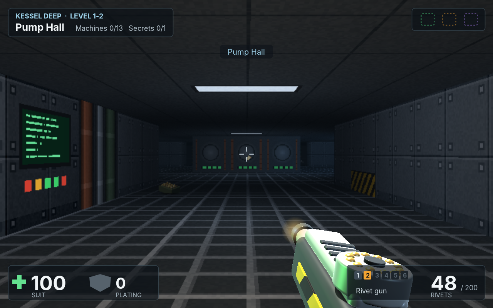

# amade-rivet-game

**amade-rivet-game** is the first-person 3D shooter of the [amadeOS](https://github.com/datazuul/amadeos) desktop. An engineer goes down into Kessel Deep, a mine under the ice of a frozen moon, where the control system called the Foreman has turned the machines against the crew. Nine levels in three sections lead from the landing pad on the surface down to the Foreman's core, with the engineer's tools for weapons. Built on [amade-game-engine](https://github.com/datazuul/amade-game-engine), whose raycaster draws the walls, floors and skies and whose model renderer turns signed-distance models into the 3D pictures of the machines, items and tools; runs on other operating systems as well.




## Playing

- The title shows the landing pad while the machines are built (the first start takes a few seconds, later starts read them from the cache). **Enter**, **Space** or **Start** opens the card: the **difficulty** (easy, normal, hard) and the **section** to start in (a section can be chosen once it has been reached). **Enter** takes the lift down, **Esc** goes back. The mouse works on the card too.
- **W A S D** walk and step sideways, the **mouse** or the **arrow keys** turn, **Shift** runs. The mouse is caught by the window while you play and let go on the cards and in the pause. *Game → Mouse Speed* sets how fast it turns.
- **Click** or **Ctrl** uses the tool in hand; **1** to **6**, **Q** or the mouse **wheel** choose another.
- **Space**, **E** or the right mouse button opens doors and works the lift. A door with a coloured frame needs the access chip of its colour: green, amber or violet. Some walls give way: those are the secrets.
- **Tab** or **M** shows the map of what you have seen so far, turned the way you look.
- The **tools**: the **ice pick** (no ammunition, close by), the **rivet gun**, the **scatter riveter** (seven rivets at once, close up), the **arc welder** (a short arc that burns while held, on battery cells), the **plasma cutter** (a slow bolt that hits hard, on gas bottles) and **blasting charges** (thrown, they go off after a moment). Empty tools switch to one that works.
- The **machines**: drones float and spark, crawlers run up and bite, sentries stand still and fire bursts, loaders throw blocks of ice, and the Foreman waits in the core. Machines notice you when they see you or hear a shot. Red canisters burst and hurt what stands near them.
- The suit has **health** and **plating**; plating takes a third of every hit. Patches, repair kits, plating and ammunition lie about; they are taken only when they help.
- The **lift** ends a level. The card shows the time against par, the machines, the secrets and the points: every machine has its points, a secret 50, and the bonus is 2 points for every second under par and 100 for a level left without machines. If the suit gives up, **Enter** tries the level again and **Esc** ends the run. A run that ends with points enters the high score table.
- **P** or **Esc** pauses, and so does leaving the window; **Q** in the pause gives up the run.
- Gamepads: d-pad or left stick to walk and turn, **LB** and **RB** step sideways, **A** uses the tool, **X** opens, **Y** the next tool, **Back** the map, **Start** pauses, **B** goes back.
- **F11** switches to full screen and back. *Game → Graphics* chooses how the view reaches the screen: **Pixels** (640 × 400, enlarged by whole factors, the default) or **Direct**. **F12** shows how long each frame takes.
- Sound effects and music can be switched off under *Game → Sound*.

The keys can be changed in `~/.config/amadeos/rivet/rivet.properties`, with the names Java gives them, several separated by spaces:

```properties
keys.forward=W UP
keys.back=S DOWN
keys.turn-left=LEFT
keys.turn-right=RIGHT
keys.strafe-left=A
keys.strafe-right=D
keys.run=SHIFT
keys.fire=CONTROL
keys.use=SPACE E
keys.next-tool=Q
keys.map=TAB M
keys.pause=P ESCAPE
```

Texts in English, Deutsch, Français, Español and Italiano.

## Gamepads

Plugged in before or while the game runs; any of them plays. *Help → About* shows how many are connected.

- **Linux**: the game reads `/dev/input/js0` to `js3`, which needs read access to them (on most desktops the user at the screen has it). The buttons follow the Xbox layout of the `xpad` driver.
- **Windows**: XInput, so Xbox and compatible controllers.
- Elsewhere the game runs without gamepads.

## Files

| What | Where |
|---|---|
| Settings (graphics, sound, mouse speed, keys, the last difficulty and section, the sections reached) | `~/.config/amadeos/rivet/rivet.properties` |
| The 3D pictures of the machines, items and tools, built at the first start | `~/.cache/amadeos/rivet/` |
| Best runs | `~/.local/share/amadeos/games/rivet/` |

## Building

```bash
./gradlew test          # the window tests need a display (xvfb-run on servers)
./gradlew run
./gradlew deb           # build/distributions/amade-rivet-game_<version>_all.deb
./gradlew installToAmadeOs   # copies the package to ../amadeos/config/packages.chroot/
./gradlew benchmark     # the frame times of every level
```

Gamepads on Windows go through Java's foreign function interface, so the game starts with `--enable-native-access=ALL-UNNAMED` (set in `build.gradle` for `run`, the tests and the packages).

All pictures are made by the game itself: the wall, floor and sky textures are painted with Java2D, and the machines, items and tools are signed-distance models that the engine renders from eight directions (`ui.game.Models`). The icon is drawn by `tools/MakeIcon.java`. `./gradlew screenshots -Pshots=<folder>` draws the handbook's screenshots.

With `../amade-game-engine` (and `../amade-commons`) checked out next to this repository, Gradle builds those checkouts instead of the JitPack versions.

## Structure

- `domain`: the rules without user interface or time of their own. `World` (one level: the grid, the player's moves and tools, machines and what they see and do, projectiles, doors, pickups, secrets, the lift), `LevelData` (the nine levels as text maps), `Run` (levels, sections, score), `Player`, `Machine` and `MachineKind`, `Weapon` and `Ammo`, `Pickup` and `PickupKind`, `Projectile`, `Prop`, `Chip`, `Difficulty`, `Input`, `Event`, `Surfaces` (what the domain needs to know of the textures).
- `repository`: `RivetSettings` (graphics, sound, mouse speed, keys, the last setup, the sections reached).
- `ui.game`: the running game on the loop thread. `RivetGame` (loop, controls, mouse look, scenes: title, setup card, play, pause, level done, dead, won), `SetupCard`, `Viewport` (the 3D view: light map, billboards, raycaster, the tool in hand), `Models` (the machines, items and tools as signed-distance models), `Art` (renders them into pictures from eight directions and caches them), `Textures` (walls, floors, ceilings, the sky), `Hud` (the panels, the map and the cards), `Effects` (events become sounds, sprites, messages, flashes and shakes), `SoundBank`, `Music` (the tunes, in MML), `Look` (colours), `Arena` (what the presenter may ask of the game).
- `ui.main`: Model-View-Presenter for everything around the game: `RivetPresenter`, `RivetView`, `RivetWindow`.

From the engine: the `raycast` package (`GridMap`, `Door`, `Texture`, `LightMap`, `Camera`, `Billboard`, `Views`, `Raycaster`, `Mover`, `Hitscan`, and in `raycast.model` `Sdf`, `Material`, `Model`, `ModelRenderer`), `MouseLook`, `HighScores`, `Gamepads`, `GameLoop`, `GameCanvas`, `Mouse`, `Sound`, `Tune` and `Mixer`, `Keyboard` and `Controls`, `SceneStack`, `FullScreen`.

Comments of the form `// --8<-- [start:name]` mark the excerpts the [Game Developer's Handbook](https://datazuul.github.io/amade-game-engine/) quotes; chapter 60 is about this game.

## Licence

[EUPL-1.2](LICENSE)
